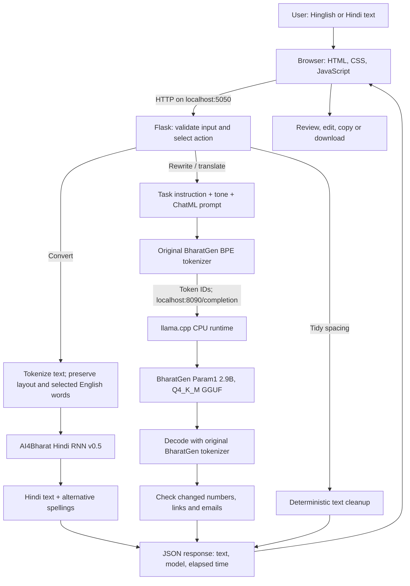

# Bol — Hinglish Smart Writing Assistant

**CS3235 mini-project · Option 4 · AI4Bharat + BharatGen**

Bol converts Roman-script Hindi into Devanagari, improves Hindi phrasing, and optionally translates it into English. It combines pretrained Indian models with a browser interface and measured evaluation.

> **Project explanation:** We built an end-to-end Hindi writing application using AI4Bharat for transliteration and BharatGen Param1 for generative writing. We integrated existing pretrained models, corrected a tokenizer compatibility issue, built the frontend/backend, and evaluated actual outputs using application-specific tests and an attributed Aksharantar sample. We did not train or fine-tune the models.

## Contents

- [What the application does](#what-the-application-does)
- [Architecture](#architecture)
- [Models and technology](#models-and-technology)
- [Datasets](#datasets)
- [What we implemented, step by step](#what-we-implemented-step-by-step)
- [The tokenizer issue and its fix](#the-tokenizer-issue-and-its-fix)
- [Evaluation results](#evaluation-results)
- [What the metrics mean](#what-the-metrics-mean)
- [Observed successes and failures](#observed-successes-and-failures)
- [Run and test the application](#run-and-test-the-application)
- [Fresh Windows setup](#fresh-windows-setup)
- [Reproduce the evaluations](#reproduce-the-evaluations)
- [Project files](#project-files)
- [Limitations and scope](#limitations-and-scope)
- [Provenance and licensing](#provenance-and-licensing)

## What the application does

| Feature | Example or behavior |
| --- | --- |
| Hindi transliteration | `mujhe kal college jana hai` → `मुझे कल college जाना है` when English preservation is enabled |
| Alternative spellings | Select a converted word and choose another model candidate |
| English preservation | Optionally retain common English terms and uppercase acronyms |
| Phrasing improvement | Ask Param1 for natural, formal, friendly or concise Hindi |
| Optional translation | Ask Param1 to translate Hindi into English |
| Manual review | Edit, copy or download the resulting text |
| Basic cleanup | Tidy spacing and punctuation without calling an LLM |

**Transliteration changes script:** `namaste` → `नमस्ते`.  
**Translation changes language:** `नमस्ते` → `Hello`.  
**Rewriting changes wording or tone** while attempting to preserve meaning.

The final implementation uses AI4Bharat and BharatGen models only. Both run locally on CPU. It requires no hosted inference API key or daily inference quota after installation.

## Architecture



Everything inside this diagram runs on the same computer. The HTTP connections are local communication between components, not calls to an external AI provider.

### Conversion flow

1. The browser sends the text and English-preservation option to Flask.
2. Flask validates the request.
3. The converter identifies Roman words while preserving whitespace, existing Hindi, punctuation, numbers, emoji, URLs and emails.
4. Eligible Roman words are sent to AI4Bharat's Hindi model.
5. The best candidate forms the initial result; other candidates become selectable alternatives.
6. The browser displays editable output.

English preservation uses a small explicit vocabulary and an uppercase-acronym rule. It is not a trained English/Hindi language detector.

### Writing flow

1. The user chooses a tone and clicks **Improve phrasing**, or chooses English translation.
2. The app uses the current output when present, otherwise the original input.
3. It constructs an editing/translation instruction asking the model to preserve meaning, names, negation, numbers, URLs and emails.
4. The original BharatGen tokenizer encodes the ChatML prompt.
5. A local llama.cpp process runs the quantized Param1 weights.
6. The original tokenizer decodes the generated token IDs.
7. Basic checks warn if digit sequences, URLs or emails changed.
8. The result remains editable.

The first writing request starts the local runtime. Later requests reuse it. Word predictions and successful duplicate writing requests are cached in memory. The app terminates a model process it started when the Python process exits normally.

### Application endpoints

| Endpoint | Purpose |
| --- | --- |
| `GET /` | Serve the interface |
| `GET /api/status` | Report selected models, installed writing assets and input limit |
| `POST /api/write` | Handle `convert`, `cleanup`, `rewrite` or `translate` |
| Local runtime `POST /completion` on port 8090 | Execute Param1 using already-encoded token IDs |

## Models and technology

| Component | Exact choice | Reason |
| --- | --- | --- |
| Transliteration model | **AI4Bharat Hindi RNN v0.5** through `ai4bharat-transliteration==1.1.3` | Small pretrained Hindi converter that works on Windows/CPU |
| Writing model | **bharatgenai/Param-1-2.9B-Instruct** | BharatGen's Hindi/English instruction model |
| Compact model artifact | `Param-1-2.9B-Instruct-Q4_K_M.gguf` | Approximately 1.82 GB; practical local CPU inference |
| Tokenizer | Original BharatGen `tokenizer.json`, read by `tokenizers==0.20.3` | Preserve the original model's tokenization and decoding |
| LLM execution runtime | **llama.cpp b12034**, Windows x64 CPU build | Runs the GGUF without installing a GPU framework |
| Backend | Python 3.10, Flask | Input handling, model integration and responses |
| Frontend | HTML, CSS, JavaScript | Responsive browser workspace |
| Other libraries | PyTorch, NumPy, pandas, requests, python-dotenv | RNN execution, supporting data operations and local HTTP/configuration |

The assignment's [IndianNLP-Transliteration link](https://github.com/AI4Bharat/IndianNLP-Transliteration) redirects to the earlier official RNN repository. **This app uses that RNN, not the newer IndicXlit transformer.**

Param1's GGUF is a **community format/precision conversion of BharatGen's model**, not an official BharatGen GGUF release or an additional base model. llama.cpp is an execution program, not another language model. Q4_K_M is a mixed quantization format using reduced-precision weights; it does not mean every operation or tensor is exactly four bits.

### Generation settings

| Setting | Value |
| --- | --- |
| Execution | Local CPU; 6 runtime threads; GPU layers disabled |
| Local context | 2,048 tokens |
| Maximum generated output | 180 tokens |
| Temperature | 0.2 |
| Seed | 42 |
| Input text limit | 2,000 characters, with an additional token-context check |
| Tones | Natural, formal, friendly, concise |

A passage that exceeds the local context or output limit returns a visible error asking for shorter text.

## Datasets

### 1. Authored application cases — 40 cases

File: [data/evaluation.json](data/evaluation.json)

These test the application itself: greetings, everyday sentences, polite requests, questions, spelling variants, ambiguity, names, punctuation, numbers, emoji, whitespace, existing Hindi, code mixing, URLs and email addresses.

They include input, expected output and an English-preservation setting where relevant. They are a pilot set written for this project, not an independent benchmark.

### 2. Official Aksharantar sample — 50 Hindi word pairs

File: [data/aksharantar_sample.json](data/aksharantar_sample.json)  
Source: [AI4Bharat Aksharantar](https://huggingface.co/datasets/ai4bharat/Aksharantar)

We downloaded the official Hindi archive and sampled from `hin_test.json`:

- Fixed random seed: **3235**.
- Selection occurred before inference.
- Eligible Roman words contain only ASCII letters and have length 2–30, matching the app's supported word inputs.
- Original identifiers, references and source groups were retained.
- The selected sample contains 21 Dakshina, 19 AK-Freq, 5 AK-NEI and 5 AK-NEF entries.
- This sample was used for **evaluation, not training**.

See [data/ATTRIBUTION.md](data/ATTRIBUTION.md) for selection details and source-dependent CC BY/CC0 attribution.

The official word sample supplements the 40 task-specific cases. It does not replace them, and its score is not presented as a full Aksharantar benchmark result.

### 3. Authored writing cases — 12 cases

File: [data/writing_evaluation.json](data/writing_evaluation.json)

Eight cases test rewriting and four test translation. They cover tone, conciseness, negation, Roman Hinglish, names, numbers, email addresses and URLs. Each has an input and reference output.

References support inspection and diagnostic overlap measurements. They are not independently collected human fluency ratings.

## What we implemented, step by step

1. **Defined the scope.** Chose the Hindi writing assistant: conversion, phrasing, optional English translation and a usable frontend.
2. **Built the frontend and Flask API.** Added text inputs, action buttons, validation and visible errors.
3. **Integrated the AI4Bharat converter.** Loaded its pretrained Hindi RNN and preserved non-word formatting around model predictions.
4. **Added review controls.** Exposed alternative spellings, editable output, English preservation, copy and download.
5. **Integrated BharatGen Param1 locally.** Selected a compact conversion so the final project uses the required sovereign-model sources without depending on hosted free quotas.
6. **Verified downloaded assets.** Pinned model/data revisions and checked model/runtime hashes.
7. **Corrected tokenizer compatibility.** Used BharatGen's original tokenizer instead of the runtime's differing default segmentation.
8. **Added prompting and checks.** Specified the action/tone and preservation requirements, and surfaced detectable changes to numbers, links or emails.
9. **Prepared evaluation data.** Kept the 40 application cases, selected a fixed Aksharantar subset and added 12 writing cases.
10. **Ran verification.** Executed automated tests, real model evaluations, and desktop/mobile browser checks.
11. **Documented actual failures.** Recorded spelling variants, tone failures, name errors and metric limitations.
12. **Prepared submission files.** Packaged source, data, reports and a printable project report while excluding environments, weights and runtime binaries.

**We did not pretrain, fine-tune, or modify the learned model weights.** Our work is application development, pretrained-model integration, compatibility correction, prompting and evaluation. There is no document retrieval or RAG component.

## The tokenizer issue and its fix

A tokenizer converts text into the numerical token IDs a model expects.

During testing, the GGUF runtime's default tokenizer agreed with BharatGen's original tokenizer on a simple English phrase but produced different token sequences for Hindi and chat-role strings. Initial outputs consequently did not follow the requested tasks reliably.

We changed the writing adapter to:

1. Build the ChatML prompt format used by the original model.
2. Encode it using the original, pinned BharatGen BPE tokenizer.
3. Send those **token IDs** to the local runtime's `/completion` endpoint.
4. Decode generated IDs with that same original tokenizer.

For example, after the correction, a direct translation check produced:

> मैं कल नहीं आ पाऊँगा। → I will not be able to come tomorrow.

This is a compatibility fix, not model training, and it does not make every generated answer correct.

## Evaluation results

These are the measured pilot results recorded on **5 November 2026**.

| Measure | 40 application cases | 50 Aksharantar word pairs |
| --- | ---: | ---: |
| Completed cases | 40/40 | 50/50 |
| Service errors | 0 | 0 |
| Exact match | 22/40 — **55.0%** | 21/50 — **42.0%** |
| Character Error Rate | **5.91%** | **15.94%** |
| Word Error Rate | 19.35% | 58.0% |
| Edit-based word accuracy | **80.65%** | **42.0%** |
| Mean case latency | 654.57 ms | 202.62 ms |

The two datasets test different things. Do not interpret their difference as a before/after improvement.

### Live Param1 evaluation

| Measure | Result |
| --- | ---: |
| Completed writing cases | **12/12** |
| Generation/service errors in this run | 0 |
| Literal digit-sequence preservation | **11/12 — 91.67%** |
| Mean character n-gram F2 against references | **0.618** |
| Mean case latency with a running local runtime | **951 ms** |

**Completion is not correctness.** Some outputs were unchanged, some missed the requested tone, and one translation had a name/mixed-language error.

The digit check flagged `10` becoming `दस`. The numeric value stayed equivalent, but its literal representation changed. This illustrates a false positive in the diagnostic check.

### Automated and browser verification

**16 automated tests passed**, covering:

- HTTP input validation and model failure responses.
- Mixed-script text, whitespace, emoji, URLs and email preservation.
- English-preservation behavior and edit-distance calculations.
- Writing-response handling, caching and truncated-output errors.
- The fixed local inference endpoint and absence of an external-provider fallback.

Model-dependent unit tests use mocked responses. The evaluations above use actual model predictions.

Browser checks verified desktop/mobile layout, conversion, Unicode-aware alternate-spelling replacement, clearing output, and live BharatGen phrasing and translation.

### Saved evidence

| File | Contents |
| --- | --- |
| [reports/evaluation.json](reports/evaluation.json) | Application metrics and all 40 predictions |
| [reports/evaluation.csv](reports/evaluation.csv) | Spreadsheet-readable application results |
| [reports/aksharantar/evaluation.json](reports/aksharantar/evaluation.json) | Official word-sample metrics and predictions |
| [reports/aksharantar/evaluation.csv](reports/aksharantar/evaluation.csv) | Spreadsheet-readable word results |
| [reports/writing_evaluation.json](reports/writing_evaluation.json) | All 12 actual writing outputs, warnings, latency and diagnostics |

## What the metrics mean

- **CER:** Total character edit distance divided by total reference characters. Insertions, deletions and substitutions count as errors. Text is NFC-normalized and measured as Unicode code points, not visual grapheme clusters. Lower is better.
- **WER:** The corresponding edit-distance calculation on whitespace-separated words. Lower is better.
- **Edit-based word accuracy:** `max(0, 1 − WER)`. This is not a human rating.
- **Exact match:** Fraction of complete outputs equal to the normalized reference. It is strict: punctuation, spaces and valid spelling variants can affect it.
- **Literal digit preservation:** Compares sets of digit sequences in input and output. It cannot prove preservation of numerical meaning, order or repetition.
- **Character n-gram F2:** Averages character 1–6-gram reference overlap, with recall weighted more than precision. It is a lexical diagnostic, **not semantic accuracy, translation accuracy or a fluency score**.
- **Latency:** Measured elapsed time per case. Conversion results exclude model loading; writing results used an already-running runtime. Caches can reduce repeated-work latency. These are local pilot timings, not a cold-start or production benchmark.

## Observed successes and failures

| Input/task | Actual result | What we learned |
| --- | --- | --- |
| `aap kaise hain?` | आप कइसे हैं? rather than आप कैसे हैं? | Word-level phonetic ambiguity remains |
| `main theek hoon` | मैं ठीक हों rather than मैं ठीक हूँ | Nasalization/vowel endings can be wrong |
| `dilli se mumbai` | दिल्ली से मुम्बई vs reference दिल्ली से मुंबई | Valid variants can reduce exact-match scores |
| Concise rewrite | मैं यह कहना चाहता हूँ कि मैं कल नहीं आ पाऊँगा। → मैं कल नहीं आ पाऊंगा। | Removed verbosity while retaining negation |
| Formal rewrite | कृपया इसे test@example.com पर भेज देना। → कृपया इसे test@example.com पर भेज दें। | Improved phrasing while preserving the email |
| English translation | मैं कल नहीं आ पाऊँगा। → I won't be able to come tomorrow. | Correct result on this example |
| Name/translation test | राहुल को 250 रुपये वापस कर देना। → Rakhul ko 250 rupees back. | Name spelling and English fluency can fail |

Full outputs, including unsuccessful cases, remain in the reports. References were not rewritten to match predictions.

## Run and test the application

### On the development computer

Double-click **[run.bat](run.bat)**, then open **http://127.0.0.1:5050**. If it is already running, refresh the browser with **Ctrl+F5**. Keep the terminal open; press Ctrl+C to stop.

The required models and runtime have already been installed on this computer. The first AI writing request can take longer while Param1 starts.

### Short demonstration

1. Enter `mujhe kal college jana hai` and convert.
2. Toggle English preservation and compare the result.
3. Select a converted word and inspect alternative spellings.
4. For concise phrasing, use `मैं यह कहना चाहता हूँ कि मैं कल नहीं आ पाऊँगा।`.
5. For formal phrasing, use `कृपया इसे test@example.com पर भेज देना।`.
6. Optionally translate `मैं कल नहीं आ पाऊँगा।` into English.
7. Edit, copy and download the output.
8. Inspect a failed case in the evaluation report and explain its limitation.

Generated outputs may vary. Review their meaning rather than expecting every wording to equal a reference.

## Fresh Windows setup

Use Python 3.10 on Windows x64:

```powershell
python -m venv .venv
.\.venv\Scripts\python.exe -m pip install -r requirements.txt -r requirements-model.txt
.\.venv\Scripts\python.exe -m pip install --no-deps ai4bharat-transliteration==1.1.3
.\.venv\Scripts\python.exe scripts/setup_sovereign.py
.\.venv\Scripts\python.exe scripts/prepare_aksharantar.py
Copy-Item .env.example .env
.\.venv\Scripts\python.exe app.py
```

The one-time model/data downloads are approximately:

| Asset | Download size |
| --- | ---: |
| Param1 Q4_K_M weights | 1.82 GB |
| Original BharatGen tokenizer | 35 MB |
| llama.cpp CPU runtime archive | 25 MB |
| Aksharantar Hindi archive | 33 MB |
| AI4Bharat Hindi RNN on first load | 43 MB |

Package installations require additional downloads. After installation, inference works offline.

The AI4Bharat package is installed with `--no-deps` because its full dependency list includes the unused Fairseq/other-language stack. `requirements-model.txt` supplies the RNN dependencies used here. Consequently, `pip check` may report unused package requirements as missing.

If package installation is disabled by `PIP_NO_INDEX`, set `$env:PIP_NO_INDEX='0'` for that installation.

### Configuration and local files

- `.env`: RNN model type, beam width and Flask port; no API credentials needed.
- `models/Param-1-2.9B-Instruct-Q4_K_M.gguf`: Param1 weights.
- `models/param1/tokenizer.json`: Original BharatGen tokenizer.
- `.tools/llama/`: Pinned CPU runtime.
- `.tmp/param1-server.log`: Local runtime diagnostics.
- Flask uses port **5050** by default; Param1 uses loopback port **8090**.

Close another process using the required port if startup reports a conflict.

## Reproduce the evaluations

Run from the project root:

```powershell
# Automated tests: no live model generation in the mocked unit tests
.\.venv\Scripts\python.exe -m unittest discover -s tests -v

# 40 task-specific conversion cases
.\.venv\Scripts\python.exe evaluate.py

# Supplemental official 50-word sample
.\.venv\Scripts\python.exe evaluate.py --dataset data/aksharantar_sample.json --output reports/aksharantar

# 12 actual local Param1 writing/translation cases
.\.venv\Scripts\python.exe evaluate_writing.py
```

Evaluators overwrite their corresponding report files. Timing can differ across machines and cache states.

Developer browser verification is implemented in [scripts/browser_check.py](scripts/browser_check.py). It requires a running app, an isolated Edge debugging instance on port 9223, and the optional Python `websockets` package. Normal app use does not require browser automation.

For packaging, [scripts/package_submission.py](scripts/package_submission.py) uses the optional `Markdown` package to render the short report and create the source ZIP. The PDF is a separately exported copy of that printable report.

## Project files

```text
app.py                       Flask routes and input validation
assistant_core.py            AI4Bharat conversion, alternatives and cleanup
writing_backend.py           Param1 process, tokenizer, prompts and decoding
templates/index.html         Browser interface
static/                      Styles and browser behavior
data/evaluation.json         40 application conversion cases
data/aksharantar_sample.json  50 official word pairs
data/writing_evaluation.json  12 writing/translation cases
data/ATTRIBUTION.md           Dataset credit and selection method
data/sovereign_provenance.json
                             Pinned sources and verified hashes
evaluate.py                  Conversion metrics and CSV/JSON output
evaluate_writing.py           Actual Param1 evaluation
tests/                       Automated tests
scripts/                     Setup, preparation, checks and packaging
reports/                     Measured results and predictions
docs/PROJECT.md              Short project report and demo notes
submission/                  Generated ZIP and printable report
models/, .tools/             Downloaded assets; excluded from source ZIP
```

## Limitations and scope

- Hindi is the enabled transliteration language.
- The converter is the older AI4Bharat RNN; sentence context and names remain difficult.
- English preservation is a heuristic.
- Param1 can miss the requested tone, leave text unchanged, or alter wording/meaning.
- Optional English translation is imperfect, particularly for names.
- Numeric/link warnings are basic diagnostics and can have false positives or miss semantic changes.
- Small evaluation sets and unreviewed reference variants limit generalization claims.
- No independent human fluency study, model training, fine-tuning or RAG was performed.
- This is a local, single-user classroom application, not a tested multi-user production service.
- Writing results are cached in memory. Runtime diagnostics stay local; no writing-history feature is implemented.
- The source ZIP excludes .env, environments, weights and runtime binaries. A fresh machine must run setup.
- A local Git repository was initialized. GitHub publication requires the student's account and is not claimed as completed.

## Provenance and licensing

Pinned sources and full hashes: [data/sovereign_provenance.json](data/sovereign_provenance.json).

| Resource | Provenance / terms recorded |
| --- | --- |
| AI4Bharat converter | Official IndicNLP-Transliteration source; MIT-licensed code |
| BharatGen original model/tokenizer | `bharatgenai/Param-1-2.9B-Instruct`; original tokenizer revision `f9b32a727458727ff515fea5d82df00ae9b7ad56` |
| Community GGUF conversion | `arunmcops/Param-1-2.9B-Instruct-GGUF`, revision `36bfaad11e8c494d982517f48e004de641def42f` |
| Aksharantar | Official dataset revision `e418c1fc928d9f5393af33268472cf20c1891be8`; source-dependent CC BY/CC0 |
| llama.cpp | Official Windows CPU build b12034; runtime archive hash verified |

The Param1 model metadata and conversion metadata identify Apache-2.0, while the original Param1 README body also mentions MIT. Consult those original terms; this project is an academic prototype and does not redistribute model weights.

Official and artifact references:

- [AI4Bharat transliteration starting point](https://github.com/AI4Bharat/IndianNLP-Transliteration)
- [Newer IndicXlit repository, for distinguishing the models](https://github.com/AI4Bharat/IndicXlit)
- [BharatGen Param1 original checkpoint](https://huggingface.co/bharatgenai/Param-1-2.9B-Instruct)
- [Param1 community GGUF conversion](https://huggingface.co/arunmcops/Param-1-2.9B-Instruct-GGUF)
- [AI4Bharat Aksharantar](https://huggingface.co/datasets/ai4bharat/Aksharantar)
- [llama.cpp runtime](https://github.com/ggml-org/llama.cpp)
